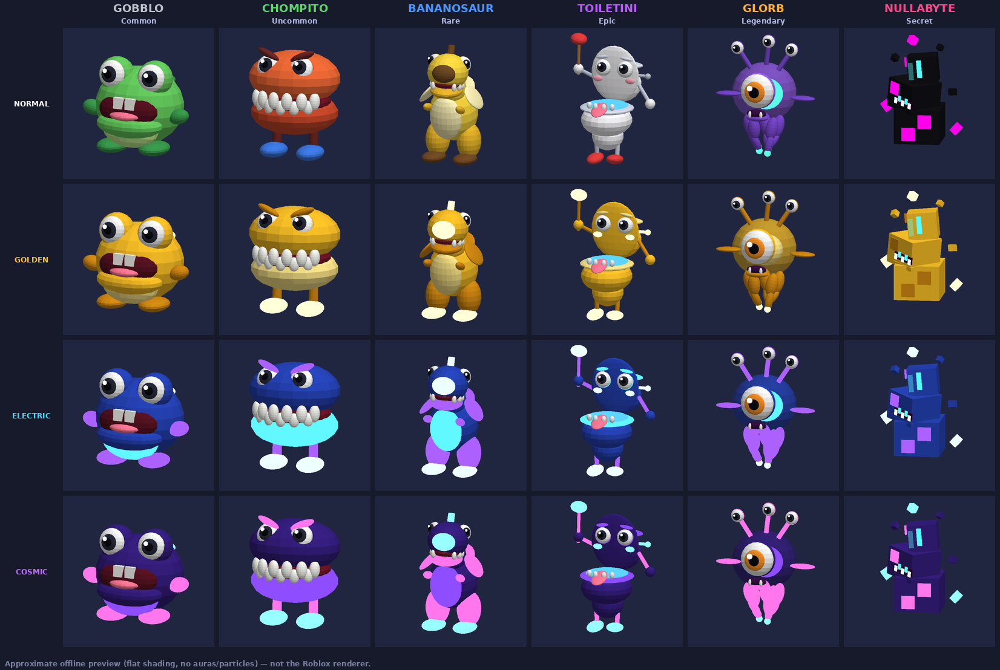
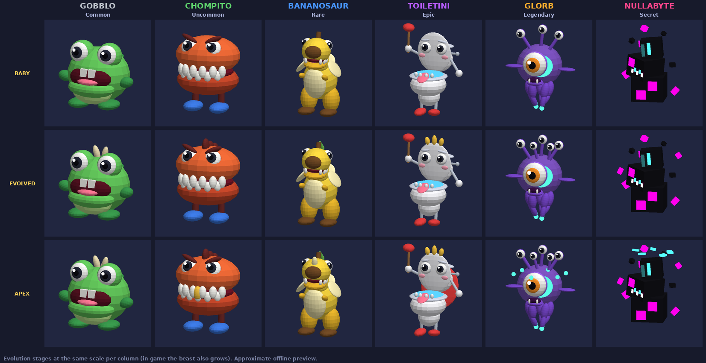
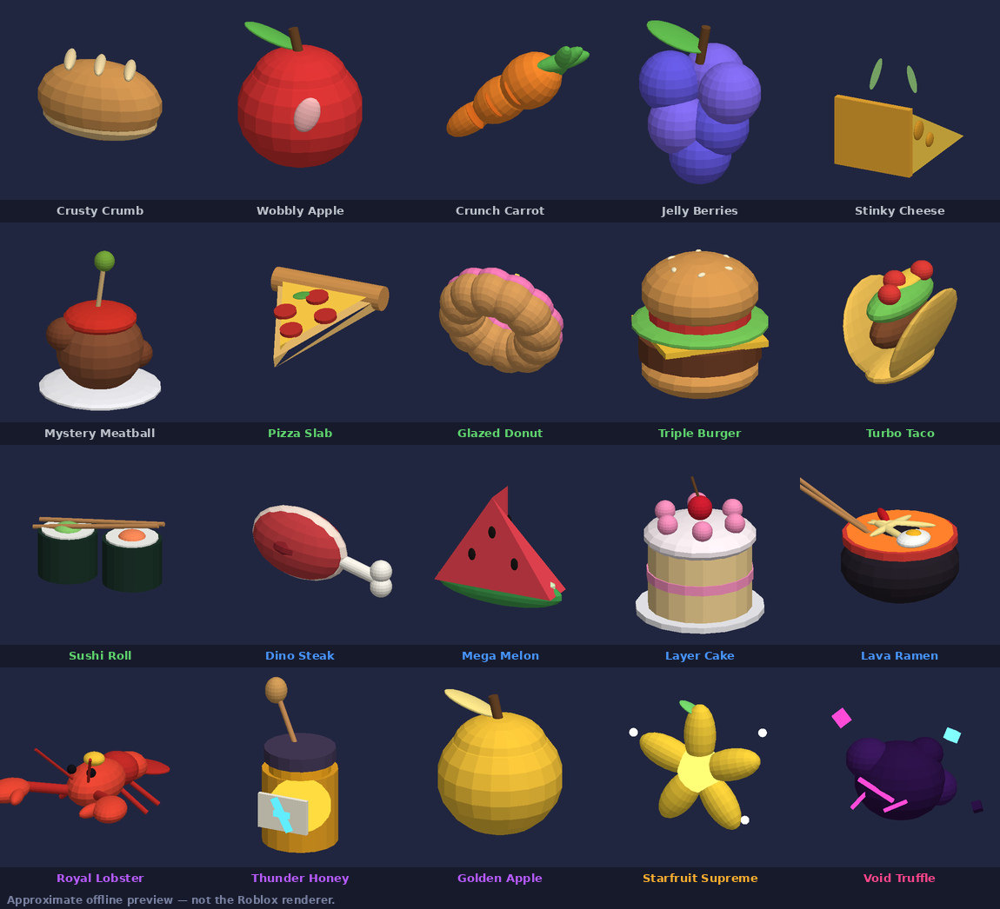
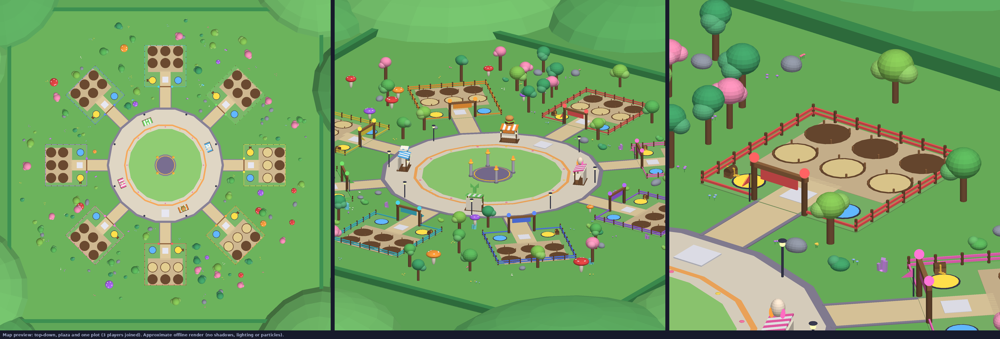

# FEED THE BEAST

*Feed it. Grow it. Steal everything.* — juego multijugador de Roblox (Luau + Rojo): cuida criaturas absurdas en tu parcela, aliméntalas para que crezcan y produzcan monedas, colecciona rarezas y mutaciones, y compite por cajas de comida que se pueden robar.

Estado: **MVP implementado y probado fuera de Roblox; pendiente de revisión visual y de juego en Roblox Studio.** Nada de lo que hay aquí se ha ejecutado todavía dentro de Roblox (ver "Qué está verificado").






> Las imágenes salen de un renderizador offline propio (`tools/preview`) que dibuja la geometría real del juego. **No son capturas de Roblox**: el aspecto final (luz, sombras, materiales, partículas) hay que revisarlo en Studio.

## Cómo abrirlo

```bash
rojo build default.project.json -o FeedTheBeast.rbxl   # y abrir el .rbxl en Studio
# o bien: rojo serve  + plugin de Rojo en un lugar vacío
```

No hay archivo de lugar con geometría: el servidor construye el mapa al arrancar (`WorldBuilder`) y cada cliente construye las criaturas. En Studio sin acceso a DataStores se juega con un perfil en memoria (aviso rojo en el HUD).

Si usas `rojo serve` sobre una plantilla, desactiva **Workspace.StreamingEnabled** a mano (Rojo no puede cambiarla en vivo; `rojo build` sí la deja en `false`).

## Estructura

| Ruta | Contenido |
|---|---|
| `src/shared/Config` | Toda la configuración: comida, criaturas, rarezas, mutaciones, economía, mejoras, huevos, eventos, robo, VFX, audio, monetización |
| `src/shared/Logic` | Lógica pura y testeada: fórmulas, esquema y migraciones del perfil, máquina de estados de robo, tiradas, validación, rate limiter |
| `src/shared/Creatures` | Kit de construcción, 6 especies procedurales y visuales de mutación |
| `src/server/Services` | Servicios autoritativos (datos, economía, criaturas, alimentación, tienda, robo, eventos, monetización, admin...) |
| `src/client/Controllers` | Estado, mundo, criaturas, auras, efectos, audio, entrada, cámara, interfaz |
| `src/client/UI` | Tema, HUD, avisos, ventanas y tutorial |
| `tests` | 8 baterías sobre el build real de Rojo, con Lune |
| `tools/preview` | Previsualización offline aproximada de criaturas y mapa |
| `docs` | Checklist de Studio, assets pendientes, monetización |

## Pruebas

Requiere `rojo`, `lune` (0.9+) en el PATH.

```bash
lune run tests/run            # todo
lune run tests/run Theft      # una batería
lune run tools/preview/run && python3 tools/preview/render.py   # imágenes en build/preview
```

Las pruebas arrancan el servidor y el cliente reales en un DataModel simulado (`tests/lib/Harness.luau`). Lune valida nombres y tipos de propiedades de las instancias, así que también detectan propiedades mal escritas en la interfaz.

## Qué está verificado y qué no

**Verificado con tests (148, todos pasan):** tareas diarias (tablero determinista, progreso, reclamación única, premio extra, cambio de día, migración v2→v3), evolución por fases, los 20 modelos 3D de comida, decoración del mapa fuera de zonas jugables y niveles de decoración de parcela; además de: economía y compras, alimentación y crecimiento, anti-duplicación, distancia medida en servidor, rate limiting y validación de remotos, mutaciones, huevos, robo/recuperación/entrega y desconexiones, anti-teleport, persistencia (migraciones, bloqueo de sesión, reintentos, fallo de carga sin sobrescribir), ganancias offline, recibos idempotentes, eventos, renacimiento en dos pasos, permisos de admin, geometría del mapa, construcción de la interfaz y flujo completo cliente↔servidor del primer minuto, límites y limpieza de VFX.

**No verificado (necesita Roblox Studio):** aspecto real de criaturas, auras, partículas e interfaz; físicas, cámara y controles táctiles; rendimiento en móvil; DataStores y MarketplaceService reales; sonidos. Ver `docs/STUDIO_CHECKLIST.md`.

## Problemas conocidos y pendientes

- Audio: no hay IDs propios. Cinco sonidos usan rutas de reserva del motor **sin comprobar** (`AudioConfig`); el resto está en silencio hasta asignar assets.
- Monetización: todos los IDs son `0` (nada es comprable). No hay cosméticos premium más allá del aura de parcela, ni huevos de pago.
- El mapa es funcional pero sobrio (sin decoración, árboles ni música).
- El Bananosaur es la especie con la silueta menos clara en la previsualización; conviene revisarla en Studio.
- No se pudo acceder a Creator Store desde este entorno: no se usa ningún asset externo.
- El equilibrio económico es una primera hipótesis sin datos de jugadores reales.
- Formato: `stylua --check` marca los archivos de configuración de una línea por entrada (intencionado). `selene` no se ha podido ejecutar (necesita descargar la API de Roblox).

## Ampliación visual y de juego (segunda fase)

Hecho en código y cubierto por tests de lógica/estructura (el aspecto real está **sin revisar en Studio**):

- **Criaturas** reconstruidas con elipsoides (`SpecialMesh`), ojos articulados (iris, párpado, brillo), boca con profundidad, parpadeo, mirada al jugador, animación desincronizada, reacción al comer y de satisfacción, y **3 fases de evolución** (niveles 15 y 35: piezas nuevas + x1.25 / x1.6 de producción).
- **Comida**: 20 modelos 3D (`src/shared/Food/FoodModels.lua`) usados en el mapa, en la mano hacia la boca al comer y como icono 3D en la barra y la tienda. Los emoji quedan solo como icono secundario en textos.
- **Mapa**: plaza con altar, puestos con toldo y rótulo físico, parcelas valladas con arco de entrada, corrales, caminos, árboles/setas/rocas/flores/cristales, colinas, atmósfera y bloom. 4 niveles de decoración de parcela con la mejora PLOT_STYLE.
- **Tareas diarias**: 3 por día (UTC) de un catálogo de 12, premio extra al reclamar las tres, todo validado en servidor (`QuestService`, `QuestLogic`, `QuestConfig`). Ventana TASKS con indicador en el menú.
- **Descubrimientos**: tarjeta de "NEW MUTATION!" cuando una mutación aparece al dar de comer.

**No hecho de la lista de la ampliación** (pendiente, por prioridad): robo más profundo (defensas/trampas), eventos raros nuevos y mercader ambulante, cápsulas adicionales (las de pago con azar requieren revisar antes la política vigente de Roblox sobre objetos aleatorios de pago), personalización libre de parcela más allá de los 4 niveles, extras de prestigio, rediseño general de la interfaz, y cualquier malla/animación/sonido externo (no se ha descargado ni inventado ningún asset: todo es geometría generada por código).
